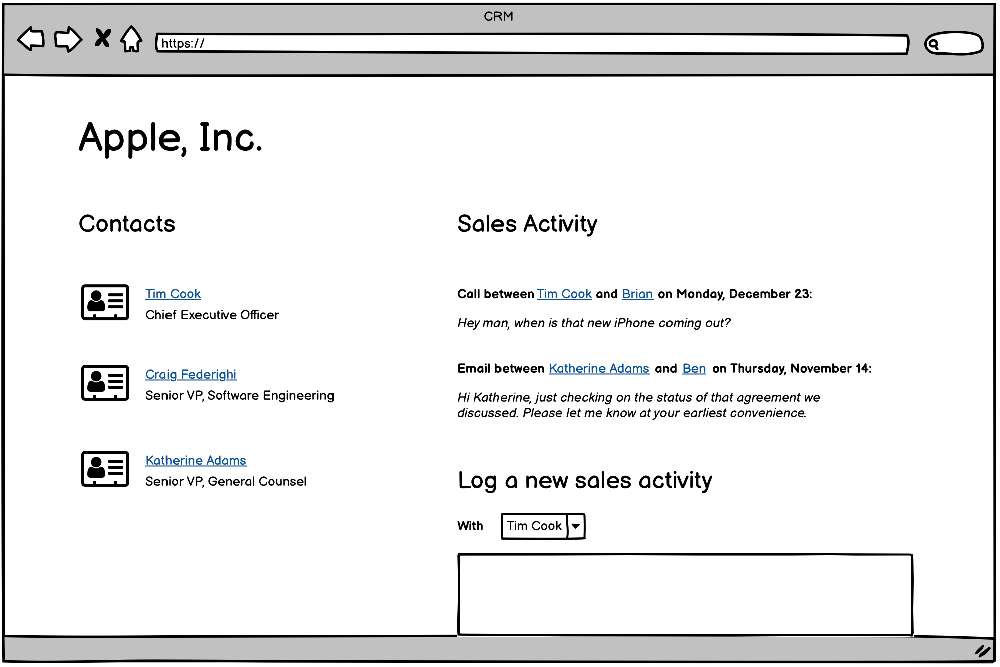

# The CRM: user stories and wireframe

A CRM (customer relationship management system) lets a sales team keep track of the companies
they sell to, the people at those companies, and every interaction they have with each person:
calls, emails, meetings. Salesforce, HubSpot and Pipedrive are CRMs. This app is a simple one.

## User stories

- As a salesperson, I want to manage a list of companies (name), so I know all the companies
  we sell to.
- As a salesperson, I want to maintain a list of contacts (along with each contact's name,
  email address, and phone number), so I know how to reach each person.
- As a salesperson, I want to associate contacts with a company, so that I can get a
  company-wide view of my sales team's communication with all the people at a company.
- As a salesperson, I want to be able to log each activity (e.g. calls or emails, with the date
  and time it occurred and my notes) I have with a contact, so I can keep a diary of all the
  communication I have with each person.
- As a salesperson, I want to maintain my own contact information (first and last name and
  email address), so that other members of the sales team know who I am.

## Wireframe: a company's page

One page per company. On the left, the people who work there. On the right, every activity
the sales team has logged with them, newest first, each naming the contact and the
salesperson, and a form to log a new one.

## From the stories to the tables

Each story names the things the app has to remember, and the wireframe shows which of their
details appear on screen. That gives four tables:

| Table | Holds | From |
|---|---|---|
| `companies` | one row per company | "a list of companies" |
| `contacts` | one row per person, with the id of their company | "a list of contacts", "associate contacts with a company" |
| `salespeople` | one row per member of the sales team | "my own contact information" |
| `activities` | one row per call, email or meeting, with the ids of the contact and the salesperson | "log each activity" |

`crm-schema.sql` has the four tables in SQL.
